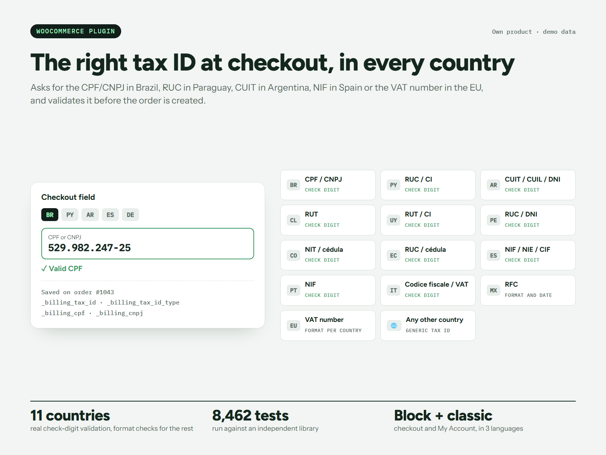

# Cedulio – Tax ID Fields for WooCommerce

[](https://github.com/nandres/fiscalo/actions/workflows/ci.yml)

Plugin de WooCommerce que pide el documento fiscal correcto según el país y lo valida antes de crear el pedido: CPF o CNPJ en Brasil, RUC en Paraguay, CUIT en Argentina, RFC en México, NIF en España o el número de IVA en Europa.

**Página del producto:** https://fiscalo-wp.vercel.app



*Los datos de la imagen son de demostración.*

> Este repositorio tiene la **versión gratis** (1.0.0). Cedulio Pro se vende aparte y su código no está acá.

## Qué hace

- **Validación con dígito verificador** en 11 países: Brasil, Paraguay, Argentina, Chile, Uruguay, Perú, Colombia, Ecuador, España, Portugal e Italia. México se valida por formato y fecha, el IVA de la Unión Europea por formato, y hay un campo genérico para el resto.
- **Número de casa, barrio y autocompletado por código postal.**
- **Checkout de bloques y clásico**, más la sección Mi cuenta.
- **Compatible con lo que ya usás:** guarda los mismos datos del pedido que Brazilian Market (`_billing_cpf`, `_billing_cnpj` y otros), e importa sus ajustes al cambiar.
- Cada pedido queda con `_billing_tax_id` y `_billing_tax_id_type`.

## Requisitos

WordPress 6.5, PHP 7.4 y WooCommerce 9.9 o superiores.

## Instalarlo

1. Bajá el repositorio con **Code → Download ZIP** y renombrá la carpeta a `cedulio` dentro del zip.
2. En WordPress, andá a **Plugins → Añadir nuevo → Subir plugin**.
3. Activalo y configurá en **WooCommerce → Cedulio** dónde pedir el documento.

## Pruebas

```bash
php tests/validator-test.php
```

Prueba números válidos e inválidos de Brasil, España y Chile sin necesidad de WordPress. El CI la corre junto con la revisión de sintaxis, en PHP 7.4 y 8.3. La suite completa contra una librería independiente, que aparece en la imagen, no forma parte de este repositorio.

## Licencia

[GPL-2.0-or-later](LICENSE).

Hecho por **Marcos Arellano** · [marcos-arellano.vercel.app](https://marcos-arellano.vercel.app)
